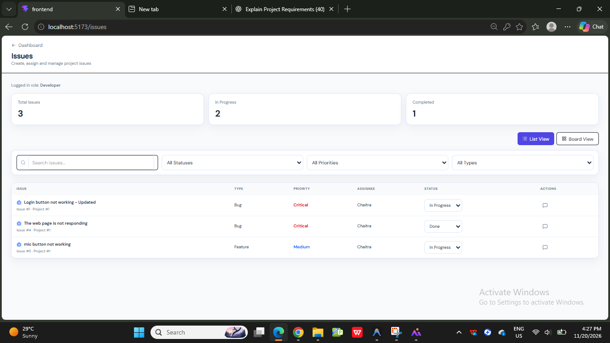
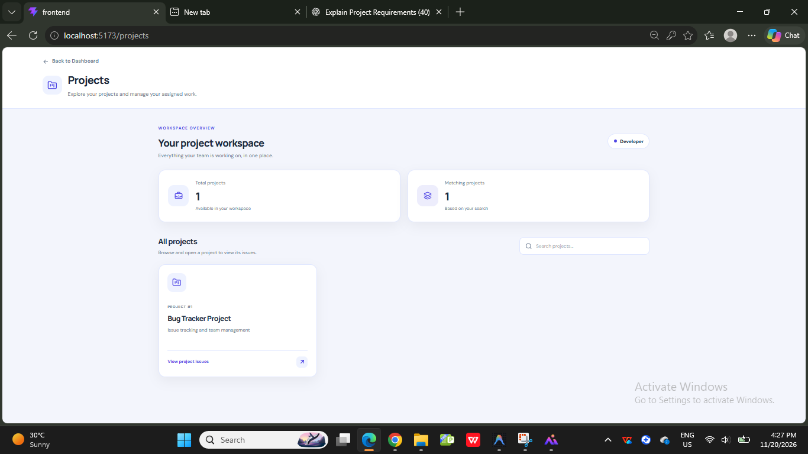

# 🐞 Bug Tracker – Issue Management System

A full-stack Bug Tracking System built to help teams manage projects, track bugs, assign issues to developers, and monitor progress through a structured workflow.

The application provides role-based access, project management, issue tracking, comments, attachments, and a Kanban-style workflow.

---

## 📌 Project Overview

Bug Tracker is a web application designed to simplify software development teamwork. It allows team members to report bugs, assign issues, update statuses, discuss problems, and manage project progress from a centralized dashboard.

## 🛠️ Tech Stack

### Frontend
- React.js
- Vite
- JavaScript
- Tailwind CSS
- Axios
- Lucide Icons
- dnd-kit

### Backend
- Python
- FastAPI
- SQLAlchemy
- PostgreSQL
- JWT Authentication

---

## 📸 Screenshots

### 1. Developer Dashboard
Overview of assigned work and project activity.


### 2. Issue Management
View, search, filter, assign, and track issues.



### 3. Project Management – Admin
Administrators can manage projects.


### 4. Project Management – Developer
Developers can view their available projects.



### 5. Registered Users
View registered users in the application.


### 6. Team Management
Manage project team members.


---

## ✨ Features

### 🔐 Authentication
- User registration and login
- JWT-based authentication
- Protected endpoints
- Current-user authentication

### 📊 Dashboard
- Overview of project and issue activity
- Dashboard based on the logged-in user

### 📁 Project Management
- Create and manage projects
- View projects
- Add team members to projects

### 🐛 Issue Management
- Create bugs, tasks, and feature requests
- Assign issues to developers
- Edit and delete issues
- Update issue status
- Search issues
- Filter issues

### 📋 Issue Workflow
Track issues through different stages of development using a Kanban-style workflow.

### 💬 Comments
- Add comments to issues
- View discussion and updates

### 📎 Attachments
- Upload screenshots and files related to issues
- View supporting attachments

### 👥 Role-Based Access Control

| Role | Permissions |
|------|------|
| Admin | Administrative access to project and user management |
| Developer | Work with assigned projects and issues |
| Viewer | Read-only access to permitted information |

Permissions are enforced through backend authorization checks.

---

## 🔄 How the Application Works

1. A user registers and logs in.
2. The backend validates credentials and returns an authentication token.
3. The user accesses authorized projects.
4. Issues are created and assigned to team members.
5. Developers update issue statuses as work progresses.
6. Team members discuss issues through comments and attachments.
7. Project progress can be monitored through the dashboard and issue views.

---

## 📂 Project Structure

```text
Bug_Tracker/
│
├── backend/
│   ├── main.py
│   ├── auth.py
│   ├── models.py
│   ├── schemas.py
│   ├── routes/
│   └── uploads/
│
├── frontend/
│   ├── src/
│   ├── public/
│   └── package.json
│
├── screenshots/
├── README.md
└── .gitignore
```

---

## ⚙️ Installation & Setup

### Prerequisites
- Python
- Node.js and npm
- PostgreSQL

### 1. Clone the repository

```bash
git clone https://github.com/chaithra-0123/Bug_Tracker.git
cd Bug_Tracker
```

### 2. Backend Setup

```bash
cd backend
python -m venv venv
```

Activate the virtual environment on Windows:

```bash
venv\Scripts\activate
```

Install dependencies:

```bash
pip install -r requirements.txt
```

Configure the database URL and required environment variables in your `.env` file.

Run the backend:

```bash
python -m uvicorn main:app --reload
```

Backend API:

http://127.0.0.1:8000

API documentation:

http://127.0.0.1:8000/docs

### 3. Frontend Setup

Open a new terminal:

```bash
cd Bug_Tracker/frontend
npm install
npm run dev
```

Frontend:

http://localhost:5173

---

## 🔒 Security

- JWT-based authentication
- Protected API endpoints
- Role-based authorization
- Backend permission validation
- Environment variables for sensitive configuration

---

## 🎯 Project Purpose

This project was developed to gain practical experience in full-stack development, REST API development, database integration, authentication, authorization, frontend-backend communication, and collaborative project management workflows.

---

## 👩‍💻 Author

**Chaithra**

GitHub: [chaithra-0123](https://github.com/chaithra-0123)

---

⭐ If you find this project interesting, feel free to explore the repository.

# 🐞 Bug Tracker – Issue Management System

A full-stack Bug Tracking System built to help teams manage projects, track bugs, assign issues to developers, and monitor progress through a structured workflow.

The application provides role-based access, project management, issue tracking, comments, attachments, and a Kanban-style workflow.

---

## 📌 Project Overview

Bug Tracker is a web application designed to simplify software development teamwork. It allows team members to report bugs, assign issues, update statuses, discuss problems, and manage project progress from a centralized dashboard.

## 🛠️ Tech Stack

### Frontend
- React.js
- Vite
- JavaScript
- Tailwind CSS
- Axios
- Lucide Icons
- dnd-kit

### Backend
- Python
- FastAPI
- SQLAlchemy
- PostgreSQL
- JWT Authentication

---

## 📸 Screenshots

### 1. Developer Dashboard
Overview of assigned work and project activity.


### 2. Issue Management
View, search, filter, assign, and track issues.


### 3. Project Management – Admin
Administrators can manage projects.


### 4. Project Management – Developer
Developers can view their available projects.


### 5. Registered Users
View registered users in the application.


### 6. Team Management
Manage project team members.


---

## ✨ Features

### 🔐 Authentication
- User registration and login
- JWT-based authentication
- Protected endpoints
- Current-user authentication

### 📊 Dashboard
- Overview of project and issue activity
- Dashboard based on the logged-in user

### 📁 Project Management
- Create and manage projects
- View projects
- Add team members to projects

### 🐛 Issue Management
- Create bugs, tasks, and feature requests
- Assign issues to developers
- Edit and delete issues
- Update issue status
- Search issues
- Filter issues

### 📋 Issue Workflow
Track issues through different stages of development using a Kanban-style workflow.

### 💬 Comments
- Add comments to issues
- View discussion and updates

### 📎 Attachments
- Upload screenshots and files related to issues
- View supporting attachments

### 👥 Role-Based Access Control

| Role | Permissions |
|------|------|
| Admin | Administrative access to project and user management |
| Developer | Work with assigned projects and issues |
| Viewer | Read-only access to permitted information |

Permissions are enforced through backend authorization checks.

---

## 🔄 How the Application Works

1. A user registers and logs in.
2. The backend validates credentials and returns an authentication token.
3. The user accesses authorized projects.
4. Issues are created and assigned to team members.
5. Developers update issue statuses as work progresses.
6. Team members discuss issues through comments and attachments.
7. Project progress can be monitored through the dashboard and issue views.

---

## 📂 Project Structure

```text
Bug_Tracker/
│
├── backend/
│   ├── main.py
│   ├── auth.py
│   ├── models.py
│   ├── schemas.py
│   ├── routes/
│   └── uploads/
│
├── frontend/
│   ├── src/
│   ├── public/
│   └── package.json
│
├── screenshots/
├── README.md
└── .gitignore
```

---

## ⚙️ Installation & Setup

### Prerequisites
- Python
- Node.js and npm
- PostgreSQL

### 1. Clone the repository

```bash
git clone https://github.com/chaithra-0123/Bug_Tracker.git
cd Bug_Tracker
```

### 2. Backend Setup

```bash
cd backend
python -m venv venv
```

Activate the virtual environment on Windows:

```bash
venv\Scripts\activate
```

Install dependencies:

```bash
pip install -r requirements.txt
```

Configure the database URL and required environment variables in your `.env` file.

Run the backend:

```bash
python -m uvicorn main:app --reload
```

Backend API:

http://127.0.0.1:8000

API documentation:

http://127.0.0.1:8000/docs

### 3. Frontend Setup

Open a new terminal:

```bash
cd Bug_Tracker/frontend
npm install
npm run dev
```

Frontend:

http://localhost:5173

---

## 🔒 Security

- JWT-based authentication
- Protected API endpoints
- Role-based authorization
- Backend permission validation
- Environment variables for sensitive configuration

---

## 🎯 Project Purpose

This project was developed to gain practical experience in full-stack development, REST API development, database integration, authentication, authorization, frontend-backend communication, and collaborative project management workflows.

---

## 👩‍💻 Author

**Chaithra**

GitHub: [chaithra-0123](https://github.com/chaithra-0123)

---

⭐ If you find this project interesting, feel free to explore the repository.
