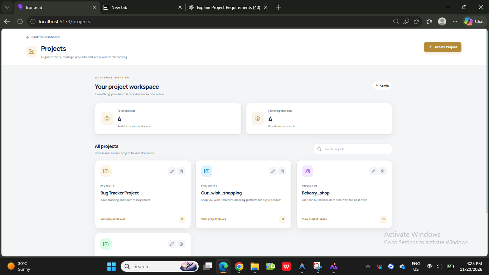
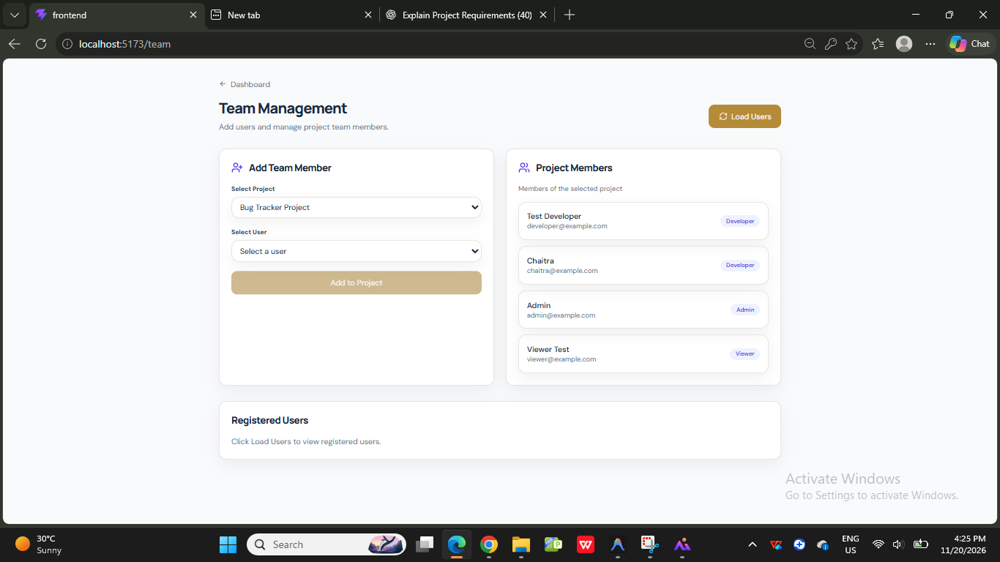
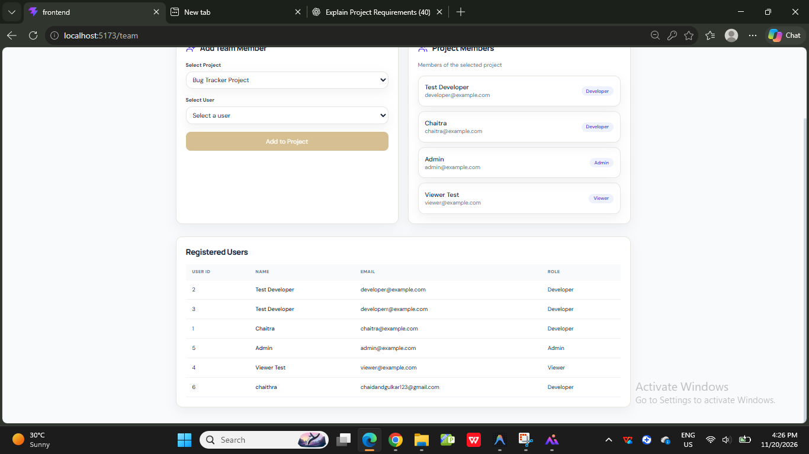
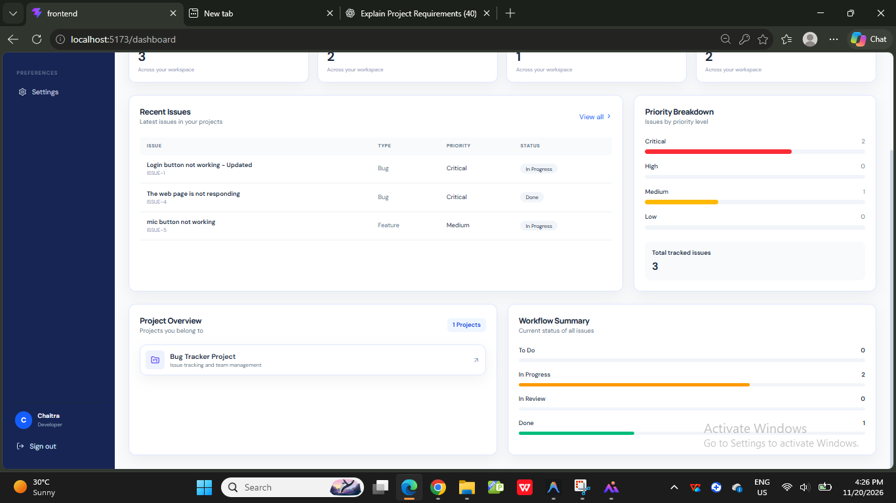

# Bug Tracker — Issue & Project Management


A full-stack web application for organizing projects, tracking bugs and tasks, assigning work to team members, and monitoring progress through a dashboard and issue workflow.


## Screenshots

### Projects workspace (Admin)


### Team management


### Registered users


### Dashboard (Developer)


### Projects workspace (Developer view)


### Issue list (Developer view)


## Features
- User registration and login with JWT-based authentication
- Role-based access control (Admin, Developer, Viewer)
- Project creation and project workspace management
- Team member assignment to projects
- Issue/bug/task/feature tracking
- Issue assignment, priority, and status updates
- List view and Kanban/board view
- Issue search and filtering by status, priority, and type
- Comments and attachment support (where enabled in the app)
- Dashboard summaries, recent issues, priority breakdown, and workflow overview

## Tech Stack

### Frontend
- React
- Vite
- JavaScript
- CSS
- Axios (API requests)
- Lucide icons

### Backend
- Python
- FastAPI
- SQLAlchemy
- PostgreSQL
- JWT authentication

## Project structure
```text
Bug_Tracker/
├── backend/       # FastAPI API, authentication, database models and routes
└── frontend/      # React application built with Vite
```

## Run locally

### Backend
```bash
cd backend
# Activate your Python virtual environment first
pip install -r requirements.txt
python -m uvicorn main:app --reload
```
Backend API documentation: http://127.0.0.1:8000/docs

### Frontend
Open a separate terminal:
```bash
cd frontend
npm install
npm run dev
```
Vite will print the local frontend address (usually http://localhost:5173).

## Configuration & security
- Configure the database connection in the backend environment file (`.env`).
- Do **not** commit `.env`, passwords, secret keys, virtual environments, or `node_modules`.
- Create your own local database and users when testing.


## Purpose
This project demonstrates full-stack development, API integration, database-backed CRUD workflows, authentication, authorization, and a role-aware user interface.
